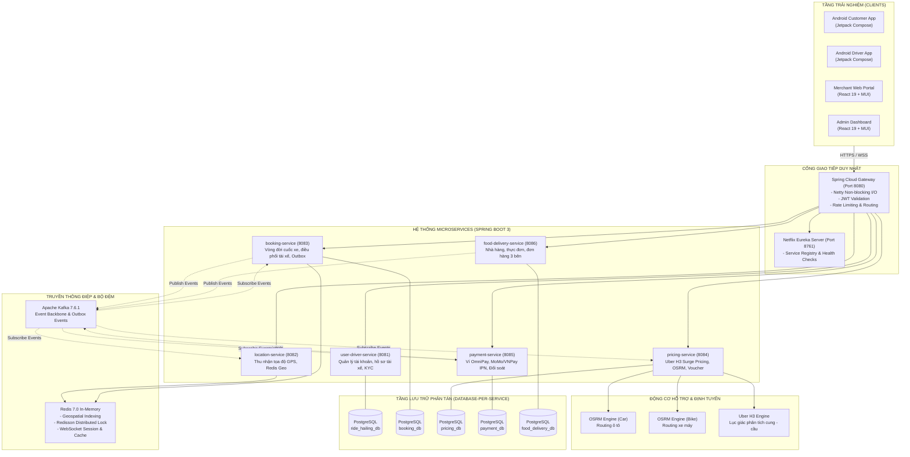
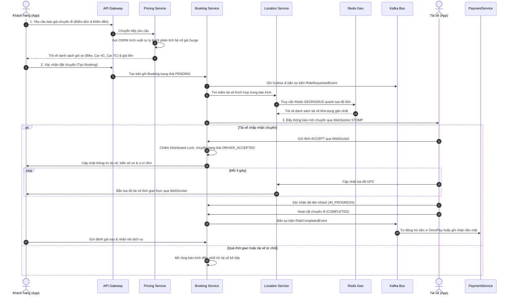
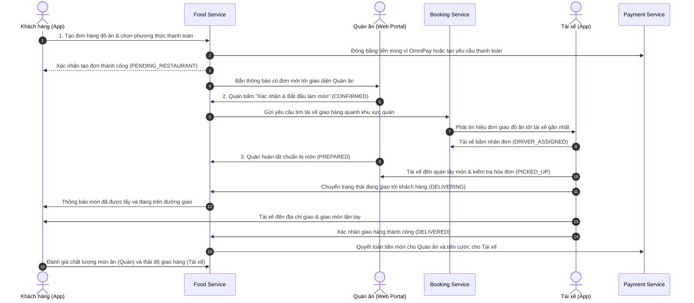

# OmniGo - Nền Tảng Siêu Ứng Dụng Đa Dịch Vụ Thông Minh
### Smart Super-App Platform for Ride-Hailing, Food Delivery & Digital Payments


Nền tảng công nghệ toàn diện cung cấp hệ sinh thái dịch vụ đặt xe trực tuyến (**OmniRide**), giao nhận đồ ăn ẩm thực (**OmniFood**) và ví điện tử tích hợp (**OmniPay**). Dự án được thiết kế và hiện thực hóa theo mô hình kiến trúc Microservices hướng sự kiện (Event-Driven Architecture) tại Backend, kết hợp ứng dụng di động Native Android hiện đại sử dụng Jetpack Compose tuân thủ chuẩn Clean Architecture.

---

## Thành Viên Phát Triển Dự Án

* **Vũ Minh Trung** (MSV: `23010361`) — Kỹ sư Kiến trúc & Phát triển Hệ thống Backend Microservices
* **Bùi Anh Quốc** (MSV: `23010328`) — Kỹ sư Phát triển Ứng dụng Di động Android (Mobile Native & UI/UX)

---

## 1. Giới Thiệu Tổng Quan

Hệ thống OmniGo giải quyết bài toán điều phối vận tải đô thị, giao nhận ẩm thực đa bên và giao dịch tài chính số với độ trễ thấp và độ tin cậy cao. Thay vì xây dựng các dịch vụ đơn lẻ, OmniGo tích hợp 3 trụ cột dịch vụ vào cùng một hệ sinh thái liền mạch:

* **OmniRide (Dịch vụ Gọi xe Công nghệ)**: Hỗ trợ đa dạng phương tiện (xe máy, ô tô 4 chỗ, 7 chỗ). Tích hợp thuật toán tính cước động theo thời gian thực (Surge Pricing) dựa trên mật độ không gian Uber H3, ghép tài xế thông minh theo bán kính và cập nhật tọa độ GPS trực tiếp lên bản đồ số.
* **OmniFood (Nền tảng Giao nhận Ẩm thực)**: Quy trình điều phối 3 bên đồng bộ và minh bạch giữa Khách hàng (Customer) — Đối tác Quán ăn (Merchant) — Tài xế giao hàng (Driver). Tự động tính khoảng cách, phí giao dịch, hỗ trợ voucher giảm giá và hệ thống đánh giá chất lượng kép.
* **OmniPay (Ví điện tử & Cổng Thanh toán)**: Hệ thống tài chính tích hợp xử lý dòng tiền nội bộ (nạp tiền, trừ ví, hoàn tiền) với cơ chế bảo đảm tính toàn vẹn (Idempotency), đồng thời kết nối trực tiếp cổng thanh toán trực tuyến MoMo và VNPay qua giao thức Instant Payment Notification (IPN).

Hệ thống phục vụ 4 nhóm người dùng chuyên biệt:
1. **Khách hàng (Mobile App)**: Trải nghiệm dịch vụ đặt xe, gọi đồ ăn, theo dõi đơn hàng thời gian thực, quản lý ví và áp dụng mã ưu đãi.
2. **Tài xế đối tác (Mobile App)**: Tiếp nhận chuyến đi, nhận đơn giao đồ ăn theo radar định vị, dẫn đường lộ trình và quản lý doanh thu minh bạch.
3. **Đối tác nhà hàng (Web Portal)**: Tiếp nhận đơn món, quản lý thực đơn, cập nhật trạng thái chế biến và thống kê doanh số.
4. **Quản trị viên (Admin Dashboard)**: Giám sát toàn bộ hoạt động hệ thống, kiểm duyệt hồ sơ tài xế (KYC), quản lý người dùng và cấu hình chính sách giá.

---

## 2. Điểm Nhấn Công Nghệ & Giải Pháp Kỹ Thuật

### 2.1. Backend Microservices Hướng Sự Kiện (Event-Driven Microservices)
* **API Gateway & Service Discovery**: Mọi yêu cầu từ Client đều đi qua Spring Cloud Gateway (xử lý bất đồng bộ trên Netty). Gateway đảm nhiệm xác thực JWT tập trung, rate limiting, định tuyến động và che giấu cấu trúc mạng nội bộ. Eureka Registry tự động phát hiện và cân bằng tải giữa các phiên bản dịch vụ.
* **Database-per-Service**: Mỗi microservice sở hữu cơ sở dữ liệu PostgreSQL độc lập, bảo đảm tính tự chủ dữ liệu, ngăn chặn việc phụ thuộc trực tiếp tầng dữ liệu giữa các nghiệp vụ.
* **Hàng đợi thông điệp Apache Kafka**: Đóng vai trò xương sống truyền thông tin bất đồng bộ. Các sự kiện vòng đời quan trọng (tạo cuốc, phân công tài xế, xác nhận món, hoàn tất đơn hàng, thanh toán) được phát tán tới các dịch vụ liên quan mà không làm nghẽn luồng xử lý chính.
* **Transactional Outbox Pattern**: Đảm bảo tính nhất quán cuối cùng (Eventual Consistency) giữa thao tác ghi cơ sở dữ liệu và việc xuất bản sự kiện lên Kafka, loại bỏ hoàn toàn nguy cơ mất mát thông điệp khi xảy ra sự cố mạng.
* **Redis Caching & Phân vùng dữ liệu**: Sử dụng Redis theo các mục đích phân lập: lưu phiên làm việc, lưu cache thực đơn và danh mục món, lưu chỉ mục không gian GPS (Redis Geospatial) và quản lý khóa phân tán (Distributed Lock qua Redisson) chống tranh chấp khi tài xế nhận cuốc.

### 2.2. Thuật Toán Định Vị Không Gian & Tính Giá Động
* **Chỉ mục Không gian Lục giác Uber H3**: Không gian địa lý được phân chia thành các ô lục giác H3 (Resolution 8 và 9). Hệ thống tổng hợp tỷ lệ cung (tài xế trực tuyến) và cầu (yêu cầu đặt xe) trên từng ô lục giác theo chu kỳ thời gian thực, từ đó tự động tính toán hệ số nhân giá (Surge Multiplier) tại các điểm nóng có nhu cầu tăng đột biến.
* **Công cụ Định tuyến Cục bộ OSRM (Open Source Routing Machine)**: Triển khai độc lập hai bộ máy định tuyến riêng cho ô tô (`osrm-car`) và xe máy (`osrm-bike`). Hệ thống tự động trích xuất khoảng cách thực tế, thời gian di chuyển theo hạ tầng giao thông và chuỗi tọa độ (polyline) để vẽ lộ trình chi tiết mà không phụ thuộc vào các API dịch vụ bản đồ bên ngoài.
* **Hàng rào địa lý (Geofencing) bằng công thức Haversine**: Tính toán khoảng cách thời gian thực giữa tài xế và điểm đón/giao với ngưỡng 50 mét để tự động phát hiện và kích hoạt trạng thái "Tài xế đã đến nơi".

### 2.3. Ứng Dụng Android Native 100% Kotlin & Clean Architecture
* **Giao diện Jetpack Compose & Material 3**: Toàn bộ giao diện người dùng được xây dựng hoàn toàn bằng Jetpack Compose khai báo, loại bỏ hoàn toàn mô hình XML truyền thống.
* **Kiến trúc MVVM + Clean Architecture**: Tách bạch 3 tầng độc lập:
  * `Domain`: Chứa Domain Entities, Repository Interfaces và các Use Case nghiệp vụ thuần khiết Kotlin, không phụ thuộc vào Android Framework hay Data Layer.
  * `Data`: Xử lý lưu trữ Local (DataStore), Remote DTOs, Retrofit Services và triển khai Repository với cơ chế Mapper hai chiều.
  * `Presentation`: Quản lý UI State bất biến qua `StateFlow`, luồng sự kiện một lần (One-shot UI Events) qua `Channel`, tuân thủ nguyên lý Unidirectional Data Flow (UDF).
* **Tokenized Design System & Quy ước Không Số Ảo (Zero Magic Numbers)**:
  * 100% khoảng cách, lề, kích thước, bo góc và kiểu chữ được quản lý tập trung qua hệ thống Design Tokens: `Dimen`, `AppSpacing`, `AppShape`, `Color`, `TypographyExt`.
  * Hỗ trợ đa ngôn ngữ đầy đủ (i18n) với việc đồng bộ khóa chuỗi trên cả 3 tập tin tài nguyên (`values/`, `values-en/`, `values-vi/`).
* **Quản lý Kết nối Thời Gian Thực Kép (Dual STOMP WebSocket)**: Tích hợp WebSocket STOMP Client duy trì kết nối bền bỉ với cơ chế tự động tái kết nối, lắng nghe đồng thời luồng vị trí tài xế và luồng trạng thái cuốc/đơn.
* **Xử lý Phiên Xác thực Bền bỉ (Mutex Refresh Token)**: OkHttp Interceptor và Authenticator kết hợp khóa `Mutex` bất đồng bộ đảm bảo việc cấp mới Access Token diễn ra an toàn, ngăn chặn xung đột cuộc gọi API song song khi phiên hết hạn.

---

## 3. Sơ Đồ Kiến Trúc Hệ Thống



---

## 4. Quy Trình Vận Hành Nghiệp Vụ Cốt Lõi

### 4.1. Quy Trình Gọi Xe Thời Gian Thực (OmniRide Lifecycle)



### 4.2. Quy Trình Điều Phối Đơn Hàng Ẩm Thực 3 Bên (OmniFood 3-Way Flow)



---

## 5. Tổ Chức Thư Mục Mã Nguồn Monorepo

```
OmniGo/
├── SRC/
│   ├── BE/                             # Hệ thống Backend Microservices (Java 17, Spring Boot 3)
│   │   ├── api-gateway/                # Cổng API Gateway tập trung, xác thực JWT, định tuyến (Port 8080)
│   │   ├── discovery-service/          # Máy chủ Eureka Service Registry & Discovery (Port 8761)
│   │   ├── user-driver-service/        # Quản lý tài khoản, hồ sơ phương tiện, xét duyệt KYC (Port 8081)
│   │   ├── location-service/           # Tiếp nhận GPS, lập chỉ mục không gian Redis Geospatial (Port 8082)
│   │   ├── booking-service/            # Vòng đời cuốc xe, điều phối tài xế, Outbox, WebSocket (Port 8083)
│   │   ├── pricing-service/            # Định giá động Uber H3, định tuyến OSRM, khuyến mại (Port 8084)
│   │   ├── payment-service/            # Quản lý ví OmniPay, tích hợp MoMo & VNPay, đối soát (Port 8085)
│   │   ├── food-delivery-service/      # Quản lý quán ăn, món ăn, điều phối đơn ẩm thực 3 bên (Port 8086)
│   │   ├── docker-compose.yml          # Kịch bản triển khai container toàn bộ dịch vụ và hạ tầng
│   │   ├── prometheus/                 # Cấu hình thu thập chỉ số vận hành hệ thống từ Actuator
│   │   └── grafana/                    # Mẫu bảng biểu giám sát tài nguyên và thông lượng
│   │
│   ├── APP/                            # Ứng dụng Android Native 100% Kotlin (Jetpack Compose)
│   │   ├── app/src/main/java/com/example/omnigo/
│   │   │   ├── core/                   # Mạng (Retrofit, OkHttp Mutex), WebSocket STOMP, DataStore
│   │   │   ├── features/               # Các phân hệ nghiệp vụ tổ chức chuẩn Clean Architecture
│   │   │   │   ├── auth/               # Xác thực, đăng ký, đăng nhập OTP/Mật khẩu
│   │   │   │   ├── home/               # Màn hình chính, chuyển đổi dịch vụ Ride / Food
│   │   │   │   ├── booking/            # Chọn tuyến đường, ước tính cước, theo dõi chuyến xe
│   │   │   │   ├── food/               # Tìm kiếm quán, thực đơn, giỏ hàng, theo dõi đơn món
│   │   │   │   ├── payment/            # Nạp ví, rút tiền, lịch sử biến động số dư, liên kết thẻ
│   │   │   │   ├── driver/             # Chế độ tài xế, nhận chuyến xe, nhận đơn giao đồ ăn
│   │   │   │   ├── profile/            # Thông tin cá nhân, cài đặt bảo mật, đổi ngôn ngữ
│   │   │   │   └── rating/             # Đánh giá chuyến đi, đánh giá quán ăn và tài xế
│   │   │   └── ui/                     # Design System (Dimen, AppSpacing, AppShape, Color, Theme)
│   │   └── app/src/test/               # Bộ kiểm thử Unit Test cho Use Cases, ViewModels, Repositories
│   │
│   └── FE/                             # Cổng Web Portal (React 19, Vite, Material UI v9)
│       ├── src/
│       │   ├── pages/merchant/         # Cổng đối tác ẩm thực: Quản lý thực đơn, nhận và xử lý đơn
│       │   ├── pages/admin/            # Cổng ban quản trị: Quản lý tài xế, duyệt KYC, phân quyền
│       │   └── services/               # Tầng giao tiếp REST API kết nối qua Gateway
```

---

## 6. Hướng Dẫn Cài Đặt & Khởi Chạy

### 6.1. Yêu Cầu Môi Trường
* Hệ điều hành: Linux, macOS hoặc Windows (khuyến nghị WSL2)
* Java Development Kit (JDK): Phiên bản 17 trở lên
* Docker & Docker Compose: Phiên bản Docker Engine 24.x trở lên
* Android Studio: Phiên bản Koala / Ladybug trở lên, Android SDK 34, Android Gradle Plugin 8.7+
* Node.js: Phiên bản 20.x trở lên (cho cổng Web Portal)

### 6.2. Khởi Động Hạ Tầng & Dịch Vụ Backend

1. **Khởi chạy cụm hạ tầng phụ trợ bằng Docker Compose**:
   ```bash
   cd SRC/BE
   docker-compose up -d postgres kafka zookeeper redis osrm-car osrm-bike
   ```
   *Cụm container bao gồm: 5 cơ sở dữ liệu PostgreSQL độc lập, Apache Kafka, cụm Redis, cùng hai động cơ định tuyến OSRM cho ô tô và xe máy.*

2. **Khởi động dịch vụ điều phối Eureka Service Registry**:
   ```bash
   cd SRC/BE/discovery-service
   ./gradlew bootRun   # Hoặc ./mvnw spring-boot:run
   ```
   *Bảng điều khiển Eureka sẽ sẵn sàng tại địa chỉ: `http://localhost:8761`*

3. **Khởi động Cổng API Gateway**:
   ```bash
   cd SRC/BE/api-gateway
   ./gradlew bootRun
   ```
   *Cổng Gateway hoạt động tại cổng `8080`, đảm nhận vai trò định tuyến tới toàn bộ dịch vụ backend.*

4. **Khởi động các Microservices nghiệp vụ**:
   Lần lượt khởi chạy các dịch vụ: `user-driver-service` (8081), `location-service` (8082), `booking-service` (8083), `pricing-service` (8084), `payment-service` (8085), `food-delivery-service` (8086).

### 6.3. Khởi Chạy Ứng Dụng Android Mobile

1. Mở thư mục `SRC/APP` bằng **Android Studio**.
2. Chờ tiến trình Gradle Sync hoàn tất tải các thư viện phụ thuộc.
3. Kiểm tra địa chỉ cấu hình kết nối Gateway trong file cấu hình mạng `NetworkModule.kt` (mặc định trỏ về máy chủ phát triển hoặc IP cục bộ của máy chủ backend).
4. Chọn thiết bị đích (thiết bị thật kết nối qua ADB hoặc máy ảo Android Emulator chạy Android 10.0+ / API 29+).
5. Bấm **Run 'app'** hoặc thực thi lệnh biên dịch:
   ```bash
   cd SRC/APP
   ./gradlew installDebug
   ```

### 6.4. Khởi Chạy Cổng Web Đối Tác & Quản Trị (Frontend)

```bash
cd SRC/FE
npm install
npm run dev
```
*Giao diện Web Portal sẽ khởi chạy tại: `http://localhost:5173`*

---

## 7. Tiêu Chuẩn Kiểm Thử & Giám Sát Vận Hành

### 7.1. Kiểm Thử Đơn Vị Phía Android (133 Test Suites)
Dự án áp dụng chặt chẽ chuẩn kiểm thử hướng hành vi (Behavior-driven Testing) nhằm đảm bảo mọi thay đổi logic nghiệp vụ đều được kiểm soát:
* **Tầng Domain (Use Cases)**: Kiểm tra toàn diện các kịch bản thành công, biên giới hạn và ngoại lệ của luồng tính giá, xác thực, đặt xe và hủy chuyến sử dụng `MockK`.
* **Tầng Presentation (ViewModels)**: Sử dụng thư viện `Turbine` kết hợp `StandardTestDispatcher` để kiểm chứng từng bước biến đổi trạng thái `StateFlow` và các sự kiện một lần phát ra từ `Channel`.
* **Tầng Data (Mappers & Repositories)**: Xác thực tính toàn vẹn của dữ liệu sau khi chuyển đổi qua lại giữa DTO mạng và Domain Entity.

### 7.2. Kiểm Thử Tích Hợp Backend (Integration Tests)
* Triển khai kiểm thử tích hợp với `Testcontainers` (khởi tạo container PostgreSQL và Kafka độc lập trong quá trình chạy test).
* Kiểm thử tính toàn vẹn của chu trình thanh toán ví điện tử và kịch bản phân công chuyến xe đồng thời nhiều tài xế.

### 7.3. Khả Năng Quan Sát & Giám Sát Vận Hành (Observability)
* **EFK Stack**: Fluentd thu thập toàn bộ log có cấu trúc từ các container microservices và chuyển tiếp vào Elasticsearch để tra cứu tập trung qua giao diện Kibana.
* **Prometheus & Grafana**: Tự động thu thập chỉ số hiệu năng (CPU, dung lượng bộ nhớ Heap JVM, số lượng luồng, độ trễ phản hồi HTTP, lưu lượng tin nhắn Kafka) từ Spring Boot Actuator để trực quan hóa trên bảng điều khiển Grafana.

---

## 8. Kết Quả Trình Diễn Đồ Án

Hệ thống đã được hiện thực hóa hoàn chỉnh, vượt qua các bài kiểm thử tích hợp thực địa và được bảo vệ thành công trước hội đồng chuyên môn:
* **Video Trình Diễn Vận Hành Hệ Thống**: Thời lượng **20 phút 02 giây** ghi lại toàn bộ luồng hoạt động trực tiếp giữa ứng dụng khách hàng Android, ứng dụng tài xế Android, cổng đối tác nhà hàng và bảng điều khiển quản trị viên.
* **Các kịch bản thực tế đã chứng minh**: Đặt chuyến xe công nghệ có áp dụng Surge Pricing và Voucher, tài xế nhận cuốc và dẫn đường GPS thời gian thực, đặt đơn đồ ăn 3 bên với quy trình chế biến - giao hàng đồng bộ, thanh toán ví điện tử tích hợp và xử lý an toàn khi mất kết nối mạng.
